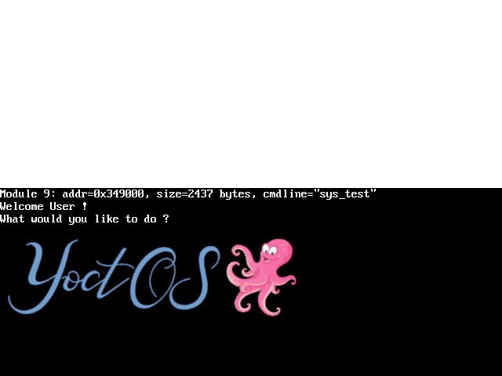

# x86 Kernel from Scratch

A small **32-bit x86 operating system** written in C and assembly: it boots with GRUB, sets up memory protection and paging, handles interrupts, drives the screen and the keyboard, and runs **user-space tasks** that talk to the kernel through **system calls**.

<p align="center"></p>
<p align="center"><sub>Booting in QEMU: GRUB loads the kernel, which prints the boot information and the GRUB modules, draws the logo, animates a sprite on every timer tick and echoes the keys typed on the keyboard.</sub></p>

> hepia (HES-SO Geneva) · Advanced Systems Programming · 2024-2025 · Solo project
> The OS is called *YoctOS* in the course.

## Features

| Area | What is implemented |
|---|---|
| **Boot** | Multiboot kernel loaded by GRUB (BIOS or UEFI), with files passed as GRUB modules (text, images, user programs) |
| **Memory** | GDT with kernel / user segments, **paging** (4 KB pages, identity-mapped kernel) and a **physical frame allocator** |
| **Interrupts** | IDT, CPU exceptions, PIC remapping, hardware IRQs |
| **Drivers** | VBE framebuffer graphics (text rendering with a bitmap font, `printf`, images), **PIT timer** (ticks, sleep, an animation refreshed on each tick), **PS/2 keyboard** with a Swiss-French keymap |
| **Tasks** | task creation, loading and freeing, with a TSS for the switch between user and kernel privilege levels |
| **System calls** | read a key, timer info, sleep, set a pixel, execute a task – used by a minimal user-space C library (`ulibc`) and test programs |

## Build & run

Requirements: Linux, `gcc` with 32-bit support, `nasm`, GRUB tools (`grub-mkrescue`, `xorriso`, `mtools`) and `qemu-system-i386`.

```bash
# Debian / Ubuntu
sudo apt install build-essential gcc-multilib nasm grub-pc-bin grub-efi-ia32-bin xorriso mtools qemu-system-x86
# Arch
sudo pacman -S base-devel lib32-gcc-libs nasm grub xorriso mtools qemu-system-x86

make run                 # build the ISO and boot it in QEMU (UEFI)
make run SYSTEM=BIOS     # boot through BIOS instead
make debug               # run QEMU waiting for GDB
make                     # list all targets and options
```

The ISO can also be written to a USB stick and booted on real hardware: `make PLATFORM=PC DEBUG=0 DEV=/dev/sdX deploy`.

## Project structure

```
├── kernel/
│   ├── boot/        Multiboot entry point and boot information
│   ├── mem/         GDT, paging, frame allocator
│   ├── interrupt/   IDT, exceptions, IRQ handlers
│   ├── drivers/     framebuffer, font, timer, PIC, keyboard, GRUB modules
│   ├── keymaps/     keyboard layouts
│   ├── task/        tasks and TSS
│   └── syscall/     system call entry and dispatch
├── common/          code shared by kernel and user space (string, stdio, memory, types)
├── user/            user-space C library and test applications
├── grub/            GRUB configuration (kernel + modules)
├── resources/       data loaded as GRUB modules (welcome text, logo, animation frames)
└── docs/            demo
```

## Tech

C · x86 assembly (NASM) · GRUB / Multiboot · paging · interrupts · QEMU · GDB · Make

## Credits & license

My code is released under the [MIT license](LICENSE).
The course provided the starting skeleton – build system, Multiboot structures, bitmap font, assembly stubs and the user-space `ulibc` – along with the empty versions of the modules implemented in this project, and the YoctOS logo.
